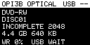
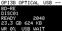
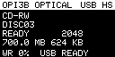

# Orange Pi 3B USB CD/DVD/BD 光驱模拟器

把 **Orange Pi 3B（RK3566）** 直接变成一台 USB 外置可重写光驱：主机看到的是
`SCSI Peripheral Device Type = 5` 的光驱（`/dev/sr0`），而不是 U 盘。光盘镜像以
普通文件放在板子上，按扩展名/`.meta` 自动选择 MMC profile：

| 文件 | 介质 | Profile | 容量 |
|---|---|---|---|
| `.ISO` | 只读 CD-ROM | `0x0008` | 按文件大小 |
| `.CDR` | CD-RW | `0x000A` | 700 MiB |
| `.DVD` | DVD-RW（Restricted Overwrite） | `0x0013` | 4.7 GB |
| `.BD` | BD-RE | `0x0043` | 25 GB |

支持 `wodim`/`cdrecord`、`growisofs`/`dvd+rw-format`/`dvd+rw-mediainfo`、ImgBurn
的刻录、格式化、擦除、TOC、Disc Structure、弹出/加载。

## 定位

这是两个姊妹项目中的 **大容量 / 高性能** 版本：

| 项目 | 定位 | 硬件 | 传输 | 介质 |
|---|---|---|---|---|
| **pi3b-cdrw-emu**（本项目） | 大容量、高性能、完整光驱 | Orange Pi 3B / RK3566 + Debian | USB 2.0 HS | CD-RW / DVD-RW / BD-RE |
| [rp2350-cdrw-emu](https://github.com/kanhuiji100/rp2350-cdrw-emu) | 即插即用、低成本、单板 | RP2350 / Pico 2 | USB 1.1 FS | CD-RW |

实测读 **31 MB/s**、写 **20.6 MB/s**，比 RP2350 方案快约 50–60 倍；
RP2350 版本无需主机守护进程、插上即用。

本目录是把 [rp2350-cdrw-emu](../rp2350-cdrw-emu) 的核心（SCSI MMC 命令集、
光盘状态机、`.CDR` + `.meta` 格式）搬到 Linux 用户态，用 **FunctionFS +
自写 Bulk-Only Transport** 代替 TinyUSB，用 **POSIX 文件** 代替 FatFs/SPI SD，
并增加 DVD-RW / BD-RE 的 profile、Format Capacities、Disc Structure 支持。

> **当前版本：v2.3.0-pi3b**
>
> 已在 Orange Pi 3B 实机验证：USB 2.0 HS 枚举、ISO 挂载、`wodim` 刻录 CD-RW、
> `growisofs` 刻录 **DVD-RW 4.7 GB** 与 **BD-RE 25 GB**、回读 sha256 一致、
> 挂载、格式化、快速擦除、托盘弹出/加载。
>
> 实测读 **31 MB/s**、写 **20.6 MB/s**（≈138x CD / 15x DVD / 4.6x BD），
> 比 RP2350 方案快约 50–60 倍。

## 功能状态

| 功能 | 状态 |
|---|---|
| USB 2.0 HS 光驱枚举（PDT=5，`sr0`） | ✅ 实机 |
| ISO9660 只读 CD-ROM | ✅ 挂载 + sha256 一致 |
| `.CDR` 可重写 CD-RW | ✅ 实机 |
| `.DVD` 可重写 DVD-RW（4.7 GB） | ✅ 实机（growisofs） |
| `.BD` 可重写 BD-RE（25 GB） | ✅ 实机（growisofs） |
| `wodim` TAO 刻录 + CLOSE SESSION | ✅ 实机 |
| Windows 空白 CD-RW 资源管理器 | ✅ 能弹出“刻录光盘”；部分版本显示 0 字节，见 TODO |
| `growisofs` DVD-RW / BD-RE 格式化+刻录 | ✅ 实机 |
| GET CONFIG / Format Capacities / Disc Structure | ✅ 实机 |
| 本地 SSD1306 OLED 状态/菜单 | ✅ 实机 0x3C 初始化 + mock 并发实测 |
| EC11 编码器浏览/新建/擦除 | ✅ 实机 GPIO 118/128/129 识别；操作待确认 |
| systemd 开机自启 | ✅ 已 enable；`/opt` + `/var/lib` |
| UI 删除镜像 | ✅ `MENU -> Delete disc`，删文件 + `.meta` |
| ImgBurn 擦除/刻录/校验/多区段 | ✅ 实机；`CLOSE SESSION` 不再误 finalize |
| 回读校验 / 挂载烧录后的盘 | ✅ 实机 |
| `BLANK` 快速擦除 | ✅ 实机 |
| 弹出 / 加载（START STOP UNIT） | ✅ 实机 |
| TOC / Disc Info / Track Info / Get Config | ✅ 实机 |
| Windows 自带 Live File System 格式化 | ❌ 进度 100% 后报错；FORMAT 后无 Track/WRITE，见 TODO |
| 运行时换盘 / 控制 socket | ❌ 未实现（重启进程换镜像） |

## 为什么可行

Orange Pi 3B 官方参数写明 **1x USB 2.0 支持 Device 或 HOST 模式**。这个口就是
**蓝色 USB 3.0 口正下方的那个 USB 2.0 口**（官方手册里用于 MaskROM 烧录的
"USB2.0 burning port"）。RK3566 的 DWC3 控制器本身支持 peripheral，只是厂商
DTB 把它写成了 `dr_mode = "host"`。

`tools/enable-otg.sh` 用 **live device-tree overlay** 把 `dr_mode` 改成
`peripheral`，再 unbind/rebind `dwc3`，**不用重启**就能得到
`/sys/class/udc/fcc00000.usb`。详见 [docs/hardware.md](docs/hardware.md)。

## 架构

```
宿主机 (PC / 本板 USB 主机口)
   │  USB 2.0 High-Speed, Bulk-Only Transport
   ▼
Linux composite + FunctionFS (内核负责枚举/标准请求)
   │  CBW / Data / CSW, GET_MAX_LUN, BOT reset
   ▼
src/usb/bot.c          传输无关的 BOT 状态机
   │  SCSI CDB + 数据阶段
   ▼
src/core/scsi.c        MMC 命令子集（与 RP2350 固件相同）
   ▼
src/core/media.c       光盘状态机 / 2048B 扇区 / .meta
   ├── .ISO：只读 CD-ROM
   ├── .CDR：CD-RW（700 MiB，fallocate）
   ├── .DVD：DVD-RW（4.7 GB，稀疏）
   └── .BD ：BD-RE（25 GB，稀疏）
   ▼
src/posix/ffshim.c     FatFs API → pread/pwrite/fallocate
src/posix/storage_posix.c  目录扫描 / 新建 / 擦除 / last-disc
src/ui/                    SSD1306 i2c-dev / EC11 GPIO / 本地菜单
```

`src/core/` 下的 `scsi.c`、`media.c`、`util.c` 基本原样复用；`media.c` 只修了
一个 seek 缓存失效的真实 bug（见 [docs/porting.md](docs/porting.md)）。

## 构建

只需要 gcc 和 make（不需要 Pico SDK / CMake）：

```bash
cd ~/dshproj/pi3b-cdrw-emu
make -j4
make test          # SCSI / media / BOT 三组主机侧测试
```

产物：`build/pi3b-cdrw-emu`。

## 快速开始（本板自环演示）

> 如果已有实例在跑，先 `sudo pkill -x pi3b-cdrw-emu`，否则 configfs 名字/挂载点
> 会冲突（可换 `--gadget cdrw1` 规避）。


准备一根 **USB-A 公对公** 数据线，连接：

```
蓝色 USB 3.0 口  <---- A-A 线 ---->  其正下方的 USB 2.0 口（OTG/Device）
```

两个口的 VBUS 来自同一路 5 V，自环是安全的。板子仍用 Type-C 供电。

```bash
# 1) 把 OTG 控制器切到 peripheral，得到 UDC
sudo tools/enable-otg.sh

# 2) 放入示例 ISO 并启动
sudo ./build/pi3b-cdrw-emu \
    --root . \
    --image ./examples/demo.iso \
    --udc fcc00000.usb
```

几秒后：

```bash
lsblk                     # sr0    11:0    1  624K  0 rom
blkid /dev/sr0            # LABEL="RPCDRW_DEMO" TYPE="iso9660"
mount -o ro /dev/sr0 /mnt
ls /mnt                   # README.TXT  DATA.BIN
```

读回整张盘并与源 ISO 比对：

```bash
sudo dd if=/dev/sr0 of=/tmp/read.iso bs=2048 count=312 status=none
sha256sum /tmp/read.iso examples/demo.iso   # 必须一致
```

## 刻录一张 CD-RW

```bash
# 1) 新建 700 MiB 空白 .CDR（不用 PC）
sudo ./build/pi3b-cdrw-emu --root . --new --no-usb
# -> ./discs/DISC01.CDR

# 2) 用空白盘启动
sudo ./build/pi3b-cdrw-emu --root . \
     --image ./discs/DISC01.CDR --udc fcc00000.usb

# 3) 主机侧刻录（wodim 是 cdrecord 的 Debian 替代）
sudo wodim -v -tao dev=/dev/sr0 speed=4 /tmp/sr0-read.iso

# 4) 回读校验
sudo dd if=/dev/sr0 of=/tmp/burned.iso bs=2048 count=312 status=none
sha256sum /tmp/burned.iso /tmp/sr0-read.iso

# 5) 快速擦除
sudo wodim -v -blank=fast dev=/dev/sr0
```

实测 64 MiB 镜像：`Writing time 3.185s`，平均 **138.3x / 20.6 MB/s**，
`BURN-Free was never needed`，回读 sha256 一致。

## 刻录 DVD-RW / BD-RE

```bash
# 4.7 GB DVD-RW：稀疏文件，实际只占 2 MiB + 写入的数据
sudo ./build/pi3b-cdrw-emu --root . --profile dvd-rw --new --no-usb
sudo ./build/pi3b-cdrw-emu --root . --image ./discs/DISC01.DVD --udc fcc00000.usb

# 25 GB BD-RE
sudo ./build/pi3b-cdrw-emu --root . --profile bd-re --new --no-usb
sudo ./build/pi3b-cdrw-emu --root . --image ./discs/DISC01.BD --udc fcc00000.usb

# 主机侧：growisofs 自动 FORMAT UNIT -> WRITE -> FLUSH/CLOSE
sudo dvd+rw-mediainfo /dev/sr0
sudo growisofs -Z /dev/sr0=./examples/demo.iso

# 回读 + 挂载
sudo dd if=/dev/sr0 of=/tmp/dvd-read.iso bs=2048 count=312 status=none
cmp -n 638976 /tmp/dvd-read.iso examples/demo.iso
sudo mount -o ro /dev/sr0 /mnt && ls /mnt
```

实测：

- `dvd+rw-mediainfo` 正确识别 `13h DVD-RW Restricted Overwrite` / `43h BD-RE`、
  4.7 GB / 25 GB 容量、Media ID、Format Capacities、Track Info。
- DVD-RW 读出 320 扇区（`growisofs` 按 16 扇区对齐补齐），前 312 扇区与源
  ISO 逐字节一致，可挂载；Disc 状态为 appendable。
- BD-RE 读出 312 扇区，烧录后 Disc 状态为 complete，可挂载。
- 25 GB 镜像为稀疏文件：`ls` 显示 24G，`du` 实际约 2 MiB（未写区不占空间）。

## 本地 OLED / 编码器（脱离 Shell）

插上 128x64 SSD1306（I2C 0x3C）和 EC11/KY-040，就能在板上完成选盘、弹出/加载、
新建空白盘、擦除和看 SCSI 调试信息，不需要 SSH。

### 接线（40-pin 排针）

| 功能 | 物理脚 | SoC GPIO | 说明 |
|---|---|---|---|
| OLED SDA | 3 | GPIO4_B4 (140) | 排针 SDA.2 |
| OLED SCL | 5 | GPIO4_B5 (141) | 排针 SCL.2 |
| OLED VCC | 1 / 17 | 3.3 V | SSD1306 用 3.3 V |
| OLED GND | 6 / 9 / 14 / 20 | GND | |
| EC11 A | 11 | GPIO3_C6 (118) | 默认 `--encoder-a 118` |
| EC11 B | 13 | GPIO4_A0 (128) | 默认 `--encoder-b 128` |
| EC11 SW | 18 | GPIO4_A1 (129) | 按下拉低，默认 `--encoder-btn 129` |
| EC11 + | 17 | 3.3 V | KY-040 模块 |
| EC11 GND | 20 | GND | |

> KY-040 自带 10 k 上拉；裸 EC11 也可以，驱动会给三根线开内部上拉。
> 裸 EC11：A/B 接 GPIO，公共端 C 接 GND，按键一端接 GPIO、一端接 GND。
> 编码器方向反了就把 A/B 两根线对调。

### 启用 I2C2 和运行

```bash
sudo tools/enable-i2c2.sh          # 运行时启用排针 I2C2，/dev/i2c-2
sudo i2cdetect -y 2                # 应看到 3c
sudo ./build/pi3b-cdrw-emu --root . --image ./discs/DISC01.BD --encoder
```

- OLED 会自动扫描 `/dev/i2c-2`（以及 0x3C/0x3D）；没插 OLED 时自动退回无 UI，
  不影响 USB 光驱。
- **编码器默认关闭**，必须显式 `--encoder`（或 service 里加），避免没接线时
  浮空引脚产生假按键。
- 编码器用独立线程 **2 ms** 采样 A/B，UI 线程只消费累计事件；如果转很多格才
  动一次，试 `--encoder-steps 2`（少数 EC11 每格只有 2 个跳变）；如果一格跳
  两下，改回 4。
- 仍然不对时用 `--encoder-debug`：正常旋转应看到
  `encoder: state 0 -> 1 -> 3 -> 2 -> 0`（或反向）；如果只在 0/1 之间来回，
  说明 A 或 B 有一根没接好。
- 没有面板时可以用 mock 渲染验证：

```bash
sudo ./build/pi3b-cdrw-emu --root . --image ./discs/DISC01.DVD      --no-usb --oled-mock /tmp/oled.pgm
python3 tools/pgm2png.py /tmp/oled.pgm /tmp/oled.png
```

### 操作

| 动作 | 效果 |
|---|---|
| 旋转 | 状态页无动作；菜单/选盘页移动光标。主菜单标题显示 `n/8`，只在选择到窗口边缘时翻页 |
| 短按 | **松开时**触发：打开菜单 / 确认 / 载入选中盘 |
| 长按（0.8 s） | 子页面返回；状态页无动作 |

菜单：`Discs`（浏览 `.ISO/.CDR/.DVD/.BD`）、`Eject/Reload`、`New blank`
（CD-RW 700 MB / DVD-RW 4.7 GB / BD-RE 25 GB）、`Delete disc`、`Erase`、
`Info`、`SCSI debug`。`Delete disc` 在前 4 行内，不用先翻页。

删除镜像：`MENU -> Delete disc -> 选盘 -> 确认`。会删除镜像文件和 `.meta`，
并清掉 `.last_disc`；**当前正在使用的盘要先 `Eject`**，否则提示
`EJECT FIRST`。如果删的是服务默认的 `DISC01.BD`，下次重启服务会以无盘状态
启动（`--image` 指向已删文件），改 unit 的 `--image` 或用 UI 载入其他盘即可。





### UI 参数

```
    --encoder         启用 EC11（默认仅显示）
    --encoder-steps N 正交跳变/格（默认 4；有些 EC11 是 2）
    --encoder-debug   打印原始 A/B 状态跳变，排查接线
    --no-encoder      仅显示
    --no-ui           完全关闭 OLED/编码器
    --i2c-bus N       OLED 总线（默认自动，优先 2）
    --oled-addr A     SSD1306 地址（默认 0x3C）
    --encoder-a N     EC11 A GPIO（默认 118）
    --encoder-b N     EC11 B GPIO（默认 128）
    --encoder-btn N   EC11 按键 GPIO（默认 129）
    --oled-mock PATH  用 PGM 帧转储代替真实面板
```

## 连接到外部 PC（重要：VBUS）

厂商 DTB 把 OTG 口的 5 V 开关（`vcc5v0_otg`，GPIO0_A5）标成 `always-on`。
如果直接用 A-A 线接 PC，板子和 PC 会同时往 VBUS 上灌 5 V。

已验证的安全做法：先关掉板子这一侧的 VBUS，让 PC 供电给端口的 VBUS 检测：

```bash
sudo tools/otg-vbus-off.sh     # unbind 调压器 + GPIO0_A5 拉低
# 然后接 A-A 线到 PC；板子必须继续用 Type-C 供电
sudo tools/otg-vbus-on.sh      # 恢复（接本板主机口或做 HOST 时）
```

本板自环测试中，关掉 VBUS 后设备仍正常枚举和读取，说明该路径有效。
更彻底的做法是在启动时应用 DT overlay 删除 `regulator-always-on`，见
[docs/hardware.md](docs/hardware.md)。

## 常用参数

```
-r, --root DIR       光盘库根目录（默认 .，内部使用 discs/）
-i, --image PATH     启动时插入的 .iso/.cdr/.dvd/.bd
-n, --new            按 --profile 新建空白盘并插入
-p, --profile NAME   cd-rw（默认）/ dvd-rw / bd-re
    --encoder        启用 EC11 编码器（默认仅 OLED 显示）
    --no-ui          关闭 OLED/编码器
    --i2c-bus N      OLED I2C 总线（默认自动）
    --oled-addr A    SSD1306 地址（默认 0x3C）
    --encoder-a/b/btn N  EC11 三个 GPIO
    --oled-mock PATH  PGM 帧转储（无面板测试）
-l, --list           列出库中的镜像
-I, --info           只打印当前介质状态
-u, --udc NAME       UDC（默认 fcc00000.usb，否则 usbip-vudc.0）
-g, --gadget NAME    configfs gadget 名（默认 cdrw0）
-L, --loopback       绑定到 usbip-vudc.0（USB/IP 实验路径）
    --no-usb         只跑 SCSI/media 核心（有 OLED 时进入 UI），不碰 USB
```

## 开机自启（systemd）

```bash
sudo deploy/install.sh
systemctl status pi3b-cdrw.service
journalctl -u pi3b-cdrw.service -f
```

安装脚本会：

- 把二进制、tools、docs 放到 `/opt/pi3b-cdrw`；
- 把当前 `discs/` 复制到 `/var/lib/pi3b-cdrw/discs`（已存在的不覆盖）；
- 安装并 `enable` `/etc/systemd/system/pi3b-cdrw.service`，然后立即启动。

服务默认是**外部 PC 模式**：

```text
ExecStartPre=otg-vbus-off.sh       # 先关板子这一侧的 OTG VBUS
ExecStartPre=enable-otg.sh         # 切 peripheral，创建 UDC
ExecStartPre=-enable-i2c2.sh       # 40-pin OLED 可选
ExecStart=... --root /var/lib/pi3b-cdrw \
    --image /var/lib/pi3b-cdrw/discs/DISC01.BD --encoder
```

- 开机自启；`Restart=always`，任何退出（包括 USB 拔出时 FunctionFS
  worker 的正常 exit 0）都会在 2 s 后自动拉起，不需要 shell 或重新上电。
- 手动 `systemctl stop` 不会被自动拉起；`start` 后 UI/OLED/编码器恢复。
- 默认插 `DISC01.BD`、启用 EC11、OLED 自动探测。
- 若编码器每格只有 2 个跳变，在 `ExecStart` 的 `--encoder` 后加
  `--encoder-steps 2`。
- 换默认盘：编辑 unit 的 `--image`，然后
  `sudo systemctl daemon-reload && sudo systemctl restart pi3b-cdrw`。
- 停止/取消自启：`sudo systemctl disable --now pi3b-cdrw`。

**本板自环**（板子自己的 USB3.0 host 口）：把 unit 里的
`otg-vbus-off.sh` 一行注释掉，执行 `sudo tools/otg-vbus-on.sh`，再用 A-A 线
接蓝色 USB3.0 ↔ 下方 USB2.0 OTG。

> 外部 PC 时板子必须由 Type-C 供电；`otg-vbus-off` 只关板子这一侧的 VBUS。
> 本次已做 `start` / `stop` / `restart` 和 `is-enabled` 验证；冷启动重启后
> 服务会自动执行同一套 ExecStartPre。

## 实测结果

| 项目 | 结果 |
|---|---|
| 枚举 | `1209:cd01`，High-Speed 480 Mbps，Product `DVD/BD USB Drive` |
| 主机驱动 | `usb-storage` + `sr_mod`，`sr0` |
| ISO 读取 | 312 扇区，sha256 与源文件一致，可挂载 |
| CD-RW 刻录 | `wodim -tao`，312 扇区，CLOSE SESSION，回读一致 |
| DVD-RW | 4.7 GB，`13h`，`growisofs` 格式化+刻录，320 扇区回读一致，可挂载 |
| BD-RE | 25 GB，`43h`，`growisofs` 自动 FORMAT UNIT+刻录，312 扇区回读一致，可挂载 |
| 64 MiB 写 | 3.185 s，20.6 MB/s，138x |
| 顺序读 | 31.0 MB/s（O_DIRECT），29.9 MB/s（带缓存） |
| 快速擦除 | CD-RW `BLANK` 后 flags=BLANK，读回全 0 |
| 弹出/加载 | `START STOP UNIT` 正常，托盘状态可逆 |
| 本地 UI | 实机 SSD1306 0x3C 初始化；128x64 mock 渲染；USB 并发状态刷新 |
| EC11 | 实机识别 GPIO 118/128/129；GPIO v2/内部上拉/读数链路通过 |
| `.meta` | v2 增加 `profile`；`COMPLETE`/`BLANK`、`data_lba`、`nwa` 正确 |

对比 RP2350 方案（USB Full-Speed + SPI SD）：

| | RP2350 | Orange Pi 3B |
|---|---|---|
| USB | 12 Mbps FS | 480 Mbps HS |
| 读 | ~0.5 MB/s | **31 MB/s** |
| 写 | ~0.4 MB/s | **20.6 MB/s** |
| 存储 | SPI SD 12 MHz | 内核 eMMC/SD |
| 介质 | CD-RW | CD-RW + DVD-RW + BD-RE |
| UI | OLED + EC11 | CLI（待加 socket/OLED） |

## 已知限制

- 同一时间只服务一张盘；换盘需要重启进程（没有控制 socket）。
- 速度上报是保守值：DVD 8x、BD 4x（实际约 15x DVD / 4.6x BD）；只影响显示/限速建议。
- DVD-RW 用 `growisofs -Z` 写入后是 **appendable**（工具没有 finalize）；数据可读可挂载，
  但盘状态不是 complete。BD-RE 会 complete。
- 只验证了 ISO9660 数据盘；UDF/UDF packet writing、DVD-Video、音频 CD 未验证。
- Windows 自带 IMAPI / ImgBurn 未验证；Linux `wodim`、`growisofs` 已实机通过。
- `dvd+rw-mediainfo` 对虚拟 DVD-RW 的 “legacy lead-out” 显示 0（结构字段的展示瑕疵，
  不影响刻录/读取）。
- 实机 SSD1306（0x3C）和 EC11（118/128/129）已识别并初始化；面板显示和
  按键操作待现场确认。OLED mock 用于布局验证；编码器默认关闭，避免未接线时
  浮空引脚误触发。
- 启动报 `ffs: cannot create /sys/kernel/config/usb_gadget/...: Operation not permitted`
  是 `libcomposite`/`usb_f_fs` 未加载（重启后常见）。v2.3 的 daemon 会自动
  `modprobe` 这两个模块；若系统里 modprobe 不可用，手动执行
  `sudo modprobe libcomposite usb_f_fs` 后再启动。
- 外部 PC 路径的 VBUS 已用本板主机口验证原理，未接真实 PC 测试。
- USB/IP `usbip-vudc` 可以枚举，但内核在关闭 FunctionFS 时会 oops
  （`vep_dequeue`），**不建议用于生产**；重启可清掉。
- 不模拟 DVD-Video/UDF packet writing/音频 CD 的完整 raw 读取。

## 目录

```
.
├── Makefile
├── src/
│   ├── core/            # 与 RP2350 共用的 SCSI/media/util
│   ├── posix/           # FatFs shim + POSIX 存储后端
│   ├── usb/             # BOT 引擎 + FunctionFS/configfs 后端
│   ├── ui/              # SSD1306 / EC11 / 本地菜单
│   └── main.c
├── tests/               # test_scsi / test_media / test_bot
├── tools/               # OTG overlay、I2C2、VBUS、启动脚本
├── deploy/              # systemd unit + install.sh
├── docs/
├── TODO.MD              # 当前任务 / 已知问题 / 同步清单
├── AGENT.MD             # 新开发者与 AI 助手的入口
└── examples/demo.iso
```

## 文档

- [可行性研究与实测](docs/research.md)
- [硬件、端口与 VBUS](docs/hardware.md)
- [移植设计与踩坑](docs/porting.md)
- [验证记录](docs/verification.md)
- [Windows USBPcap 抓包分析与 CD-RW 对齐](docs/windows-capture.md)
- [TODO](TODO.MD) / [AGENT](AGENT.MD)（接手开发先读）

GitHub: <https://github.com/kanhuiji100/pi3b-cdrw-emu>

## 许可

MIT。`src/core/` 派生自 RP2350 CD-RW Emulator（MIT）；TinyUSB/FatFs 仅存在于
原固件，本移植不含其代码。
